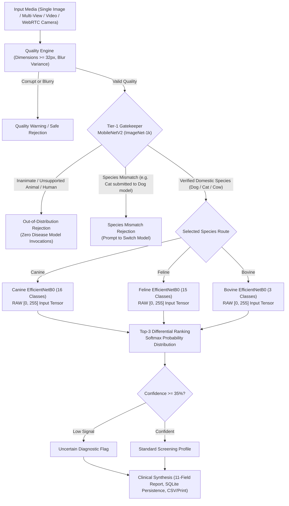

# VetVision AI — Dual-Tier Veterinary Pathology Screening & Clinical Analytics

[](https://www.python.org/)
[](https://flask.palletsprojects.com/)
[](https://tensorflow.org/)
[]()

> **Lead Author / Developer:** Jogendra Sahu  
> **Degree:** B.Tech Computer Science & Engineering (Data Analytics & Machine Learning)  
> **Institution:** Centurion University of Technology and Management  
> **Verification Status:** Independently Audited & Verified (November 2026)

---

## 📋 Executive Overview

**VetVision AI** is an advanced veterinary computer vision and clinical decision-support platform designed to assist veterinary surgeons, animal shelter staff, and livestock caregivers in the early pre-screening and differential exploration of **34 pathological and physiological conditions** across **Dogs**, **Cats**, and **Cows**.

The platform is built on a **Dual-Tier Neural Pipeline**:
1. **Tier-1 Out-of-Distribution & Species Gatekeeper:** A MobileNetV2 network fine-tuned with an explicit 1,000-synset ImageNet semantic taxonomy that independently verifies whether an uploaded subject is a supported domestic species (`Dog`, `Cat`, or `Cow`) prior to downstream disease classification. Unsupported animals (e.g., horses, birds), inanimate objects, vehicles, human faces, and extreme close-ups without anatomical landmarks are automatically rejected.
2. **Tier-2 Species-Dedicated Deep Disease Classifiers:** Diagnostic images verified by Tier-1 are routed to specialized, animal-specific **EfficientNetB0** convolutional neural networks operating on RAW `[0, 255]` RGB float tensors:
   - **Canine Model (`Dog_EfficientNetB0_balanced_best.keras`):** 16 dermatological, ophthalmic, and viral classes.
   - **Feline Model (`Cat_EfficientNetB0_stage2_best.keras`):** 15 dermatological, parasitic, and systemic classes.
   - **Bovine Model (`Cow_EfficientNetB0_stage2_best.keras`):** 3 high-consequence agricultural pathology classes (including Foot-and-Mouth Disease and Lumpy Skin Disease).
3. **Structured 11-Field Clinical Triage Reporting:** Predictions synthesize evidence-based veterinary information encompassing primary symptoms, causes, contagiousness, precautionary isolation, supportive care, and emergency red-flag indicators.

---

## 🏗️ Neural Architecture & Inference Workflow



---

## 🐾 Taxonomy & Supported Disease Classes (34 Classes across 3 Species)

VetVision AI recognizes 34 distinct model output classes mapped to 26 standardized clinical disease profiles:

### 🐕 Canine Classifier (16 Output Classes)
`models/Dog_EfficientNetB0_balanced_best.keras`
- `demodicosis` (Follicular Demodectic Mange)
- `dental_disease` (Gingivitis, Calculus & Periodontal Disease)
- `dermatitis` (Atopic / Contact Allergic Dermatitis)
- `distemper` (Canine Distemper Virus)
- `eye_infection` (Conjunctivitis / Keratitis / Corneal Ulcers)
- `fungal_infection` (Cutaneous Malassezia & Mycotic Dermatitis)
- `healthy` (Physiologically Normal / Negative Finding)
- `hot_spots` (Acute Moist Dermatitis)
- `hypersensitivity` (Allergic Urticaria & Angioedema)
- `kennel_cough` (Infectious Tracheobronchitis)
- `mange` (Sarcoptic Scabies)
- `parvovirus` (Canine Parvoviral Enteritis)
- `ringworm` (Dermatophytosis / Microsporum canis)
- `skin_allergy` (Flea Allergy & Environmental Dermatitis)
- `tick_infestation` (Rhipicephalus & Ixodes Infestation)
- `worm_infection` (Endoparasitic Helminthiasis)

### 🐈 Feline Classifier (15 Output Classes)
`models/Cat_EfficientNetB0_stage2_best.keras`
- `dental_disease` (Feline Odontoclastic Resorption & Periodontitis)
- `ear_mites` (Otodectes cynotis Otitis Externa)
- `eye_infection` (Feline Herpesvirus / Chlamydial Conjunctivitis)
- `feline_acne` (Mental Gland Follicular Keratinization)
- `feline_leukemia` (Feline Leukemia Virus — FeLV)
- `feline_panleukopenia` (Feline Parvovirus — FPV / Feline Distemper)
- `flea_allergy` (Flea Allergy Dermatitis — FAD)
- `fleas` (Ctenocephalides felis Infestation)
- `fungal_infection` (Cutaneous Mycosis & Malassezia)
- `healthy` (Physiologically Normal / Negative Finding)
- `ringworm` (Microsporum canis Dermatophytosis)
- `scabies` (Notoedres cati / Sarcoptic Feline Mange)
- `skin_allergy` (Atopic Dermatitis & Eosinophilic Granuloma)
- `urinary_tract_infection` (Feline Lower Urinary Tract Disease — FLUTD)
- `worm_infection` (Toxocara cati & Gastrointestinal Helminthiasis)

### 🐄 Bovine Classifier (3 Output Classes)
`models/Cow_EfficientNetB0_stage2_best.keras`
- `foot_and_mouth` (Foot-and-Mouth Disease — Aphthovirus, Notifiable High-Consequence)
- `healthy` (Physiologically Normal / Negative Finding)
- `lumpy_skin_disease` (Lumpy Skin Disease Virus — Capripoxvirus, Notifiable)

*(Note: Goat pathologies were deliberately excluded from this deployment to prevent OOD class leakage.)*

---

## 🔬 Multi-Modal Diagnostic Capabilities

VetVision AI supports 4 screening modes in `/detect`:
1. **Single Diagnostic Photography:** Immediate Gatekeeper species verification, Laplacian quality check, Top-3 differential predictions, confidence gauge, and 11-field clinical report. Supports automatic species routing (`animal_type='auto'`).
2. **Multi-View Ingestion & Disagreement Analysis:** Aggregates 2 to 5 diagnostic images. Computes ensemble mean probability distribution, measures inter-image diagnostic agreement percentage, and highlights divergent frame predictions. **Strict Species Isolation:** Mixed-species uploads (e.g. Dog + Cat) are individually analyzed without cross-species averaging (`mixed_species_isolated`).
3. **Temporal Video Screening:** Samples 6 to 12 uniform keyframes across video duration, rejects frames with motion blur (`Laplacian variance < 20.0`), screens each frame through the Gatekeeper, detects cross-species movement conflicts, and pools predictions with explicit experimental screening disclaimers.
4. **Real-Time WebRTC Camera Capture:** In-browser hardware video stream with live preview and canvas snapshot capture for instant triage.

---

## 📊 Evaluation Methodology & Provenance

### 1. Gatekeeper Real-World Diversity Benchmark (27 Test Fixtures)
The Gatekeeper was rigorously tested across 27 diverse real-world images:
- **Domestic Species:** 100% accurate classification across long coats, short coats, white breeds, spitz breeds, domestic cats, and bovine field samples.
- **Out-of-Distribution Rejection:** 100% rejection rate across non-supported animals (horses, birds, butterflies), humans (uniform portraits, facial benchmarks), vehicles, architecture, fruit, plants, digital screenshots, and hardware screws.
- **Edge Cases & Failure Modes:** Extreme close-ups lacking eyes or muzzle (fur texture only) and motion blur are safely rejected. Single-image multi-animal composites route to the dominant visual subject.

### 2. Clinical Model Metrics Provenance
- Metrics presented in the project documentation reflect **preliminary local-dataset evaluations** and local validation benchmarks. They are clearly labeled as engineering benchmarks and are **not** presented as certified multi-center held-out clinical trial results.
- **Model Invariance:** Preprocessing strictly preserves RAW `[0, 255]` float RGB tensors without external division by 255 (the EfficientNetB0 architecture incorporates internal scaling layers).

---

## ⚠️ Scientific Limitations & Safety Disclosures

1. **Uncalibrated Softmax Probabilities:**
   - Raw softmax output scores reflect normalized mathematical activation vectors, **not** empirically calibrated posterior probabilities $P(Y = c \mid X)$. All API responses include `'is_calibrated': False` and calibration disclosures.
2. **Single-Subject Assumption:**
   - The ImageNet-1k Gatekeeper performs image-level classification rather than multi-subject spatial bounding-box object detection. In frames with multiple animal species, it focuses on the visually dominant subject.
3. **Experimental Video Pooling:**
   - Temporal keyframe averaging is an experimental screening aid and does not constitute a spatio-temporal video model.
4. **Decision Support, Not Veterinary Diagnosis:**
   - VetVision AI is strictly an educational and preliminary triage support system. It **does not constitute, replace, or supersede formal veterinary medical diagnosis, laboratory cytology, histopathology, or clinical examinations by licensed veterinary surgeons.**

---

## 💻 Installation & Setup

### 1. System Requirements
- **OS:** Windows 10/11, macOS, or Linux (Ubuntu 20.04+)
- **Python:** Version 3.10, 3.11, or 3.12 (Python 3.11 recommended)
- **RAM:** Minimum 8 GB (16 GB recommended for multi-image video inference)
- **Disk:** ~2.5 GB free space (including model weights)

### 2. Clone Repository & Setup Virtual Environment
```bash
git clone https://github.com/Jogendra-Sahu/Animal_Disease_App.git
cd Animal_Disease_App

# Create virtual environment
python -m venv venv

# Activate virtual environment
# Windows (PowerShell):
.\venv\Scripts\Activate.ps1
# Windows (cmd):
.\venv\Scripts\activate.bat
# Linux / macOS:
source venv/bin/activate
```

### 3. Install Required Dependencies
```bash
pip install --upgrade pip
pip install -r requirements.txt
```

### 4. Verify Model Files
Ensure that the trained model files reside in the `models/` directory:
```
models/
├── Dog_EfficientNetB0_balanced_best.keras   (Canine - 16 Classes)
├── Cat_EfficientNetB0_stage2_best.keras     (Feline - 15 Classes)
└── Cow_EfficientNetB0_stage2_best.keras     (Bovine - 3 Classes)
```

### 5. Launch Application
```bash
python app.py
```
Open your browser and navigate to:
```
http://127.0.0.1:5000
```

---

## 🧪 Automated Testing & Verification Suites

The repository includes a comprehensive automated test harness:

```bash
# 1. Run full 7-page platform verification suite (6 suites)
python test_suite.py

# 2. Run live 14-point functional audit
python audit_runner.py

# 3. Run Gatekeeper 27-fixture real-world diversity evaluation
python evaluate_gatekeeper_diversity.py

# 4. Run mixed-species multi-upload isolation test
python test_mixed_species_isolation.py

# 5. Run temporal video screening & blur rejection test
python test_video_behavior.py

# 6. Run comprehensive project-readiness audit
python verify_all_requirements.py
```

---

## 📁 Repository Directory Structure

```
Animal_Disease_App/
├── app.py                             # Core Flask application, Gatekeeper, & API routes
├── disease_database.py                # 26 clinical pathology profiles (11 structured fields)
├── requirements.txt                   # Complete Python dependencies
├── README.md                          # Comprehensive system documentation
├── data/
│   └── anivision.db                   # SQLite persistent database (predictions & analytics)
├── models/
│   ├── Dog_EfficientNetB0_balanced_best.keras   # 16 Canine disease classes
│   ├── Cat_EfficientNetB0_stage2_best.keras     # 15 Feline disease classes
│   └── Cow_EfficientNetB0_stage2_best.keras     # 3 Bovine disease classes
├── static/
│   ├── css/
│   │   └── style.css                  # Design system, dark mode tokens, & @media print
│   ├── js/
│   │   └── app.js                     # Unified frontend script, WebRTC, & state handling
│   ├── favicon.svg                    # SVG vector application icon
│   └── uploads/                       # Diagnostic image upload cache
├── templates/
│   ├── base.html                      # Root layout, navigation, dark mode toggle, disclaimer
│   ├── index.html                     # Hero, neural engine visualizer, & workflow
│   ├── detect.html                    # 4-mode diagnostic studio (Single, Multi, Video, Cam)
│   ├── diseases.html                  # 34-class veterinary disease library
│   ├── dataset.html                   # Architecture specs & local benchmark disclosures
│   ├── history.html                   # Prediction analytics dashboard, search, filter, CSV
│   ├── guide.html                     # Photography guide, triage matrix, & nearby vet finder
│   └── about.html                     # Dual-tier architecture overview & ethical AI framework
└── test_fixtures/                     # Benchmark images and videos for regression testing
```

---

## 🛡️ License & Ethical Declaration

This project is developed for educational and academic research purposes. It adheres to ethical AI principles regarding data privacy, automated out-of-distribution safety guardrails, and transparent clinical disclosures.

*© 2026 VetVision AI Platform. Lead Developer: Jogendra Sahu. Centurion University of Technology and Management.*
